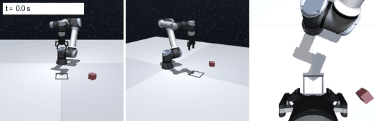
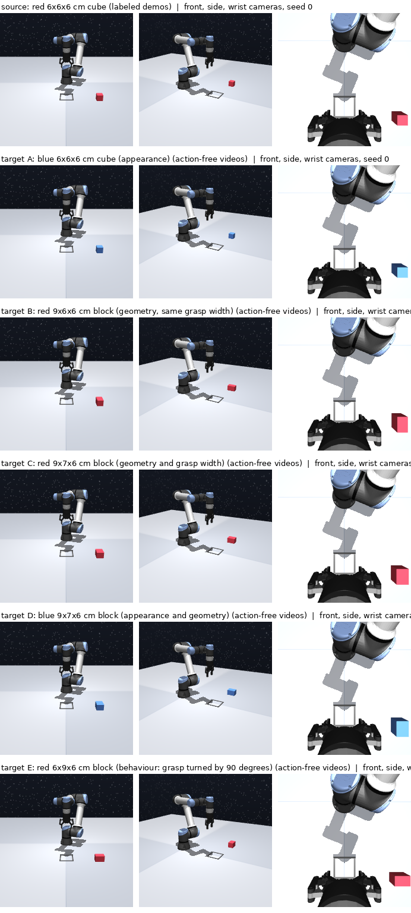

# Learning to Manipulate a New Object from Action-Free Videos

McGill ECSE 552 (Deep Learning), Fall 2026, group 9. A UR5e arm with a Robotiq gripper
(OCBench, MuJoCo) moves a cube into a goal square, seen by three RGB cameras. Labeled demos
exist only for the red **source** cube; each **target** object has only videos. An inverse
dynamics model (IDM), adapted with DANN, labels those videos, and an image-only ACT policy
trains on both. Plan, methods (a)–(f), requirements R1–R6: [proposal](docs/proposal/main.pdf).





## Status (10 November 2026)

- **Project data: `deterministic` demonstrations** (cube yaw fixed at 0; expert without
  detours, at fixed speed), for every method and object. Published: source, held-out source
  test and target A. The `stochastic` variant (stock OCBench: random yaw, detours, random
  speed) is kept for reference.
- Baseline (a) with the **original ACT** (`third_party/act`, unmodified), 300 demos, seed 0:
  **99% on the source cube with images only**, 7% on target A (stochastic data: 53% and 0%).
  Results: [docs/experiments/act_original.md](docs/experiments/act_original.md).
- Not yet: IDM (`idm.py`), DANN, targets B–D.

## Setup

Linux, [uv](https://docs.astral.sh/uv/), NVIDIA GPU with EGL for rendering.

```bash
git clone --recurse-submodules https://github.com/BrikHMP18/ecse-552-project.git
cd ecse-552-project
uv sync --locked
uv run pytest
MUJOCO_GL=egl uv run python scripts/render_cameras.py   # (3, 224, 224, 3)
```

Update: `git pull && git submodule update --init --recursive && uv sync --locked`.
If torch then cannot load `libcudnn`, recreate the env: `rm -rf .venv && uv sync --locked`.

## Workflow

```bash
# Collect (seeds: configs/data.toml), check, publish
MUJOCO_GL=egl uv run python scripts/collect_demos.py --object source --num-episodes 300 --base-seed 0
MUJOCO_GL=egl uv run python scripts/replay_episode.py data/source-deterministic-n300-seed0/episode_00000.npz
uv run python scripts/view_episode.py data/source-deterministic-n300-seed0 --episodes 0 1 2
uv run python scripts/upload_dataset_hf.py data/source-deterministic-n300-seed0 data/A-deterministic-n200-seed100000

# Train original ACT on Modal (pushes checkpoints to HF)
modal run scripts/modal_train.py --smoke
modal run --detach scripts/modal_train.py --num-episodes 300 --seeds 0,1,2

# Select (validation rollouts), test once, diagnose
hf download Autobrik/ecse552-act-deterministic --local-dir outputs/act_deterministic
MUJOCO_GL=egl uv run python scripts/select_checkpoint.py outputs/act_deterministic/n300/seed*
MUJOCO_GL=egl uv run python scripts/evaluate_policy.py outputs/act_deterministic/n300/seed0/selected.ckpt --object A
MUJOCO_GL=egl uv run python scripts/diagnose_failures.py outputs/act_deterministic/n300/seed0/selected.ckpt
```

Modal access: ask Brik. Runs that publish require a clean working tree.

## Protocol

Fixed in [`configs/data.toml`](configs/data.toml) `[protocol]` before results:

- **Data:** the `deterministic` collections (scene `fixed_yaw`, expert `deterministic`) for
  every method and object; the `stochastic` ones (stock OCBench) are a reference.
- **R2:** 100 source demos if they reach 80% on validation rollouts, else 300 (proposal).
- **ACT:** upstream code and hyperparameters; chunk 20 (2 s at 10 Hz), 2,000 epochs, upstream's
  random 80/20 episode split, absolute joint targets as actions, temporal ensembling (k = 0.01)
  at evaluation. Only change: robot state is zeroed (R3, images only).
- **Selection:** `policy_best.ckpt` (upstream: lowest validation loss) vs `policy_last.ckpt`,
  100 source validation rollouts (seeds 900,000+); ties to best.
- **Test:** each selected checkpoint once, 100 rollouts per object (seeds 1,000,000+), 3 seeds;
  mean, std, 95% CI. GPU rendering is not bit-exact, so reruns vary; report intervals.
- Held-out source demos (seeds 50,000+) are only for the IDM test error.

## Data and models

| | |
|---|---|
| Episodes (`.npz`) | [Autobrik/ecse552-ocbench-block](https://huggingface.co/datasets/Autobrik/ecse552-ocbench-block) |
| LeRobot copies (visualizer) | [ecse552-ocbench-source](https://huggingface.co/datasets/Autobrik/ecse552-ocbench-source), [ecse552-ocbench-A](https://huggingface.co/datasets/Autobrik/ecse552-ocbench-A) |
| ACT checkpoints | [ecse552-act-deterministic](https://huggingface.co/Autobrik/ecse552-act-deterministic) (project data), [-act-stochastic](https://huggingface.co/Autobrik/ecse552-act-stochastic), [-act-deterministic-proprio](https://huggingface.co/Autobrik/ecse552-act-deterministic-proprio) |
| Training curves | W&B `mu-robotics/ecse552` |

Each collection records every seed, the scene and the expert's deliberate detours
(`manifest.json`, `initial_states.csv`). Target actions are for the oracle (d) and evaluation
only (R1); simulator state is never a model input (R3).

## Decisions that differ from the proposal

| Topic | Decision | Proposal |
|---|---|---|
| Control | 10 Hz, at most 200 steps; ACT chunk 20 (2 s) | 50 Hz, chunk 25 |
| Actions | absolute joint targets (ACT); OCBench deltas computed by the low-level controller | joint increments |
| Goal / success | 12 cm gray square; cube inside, resting, released, still for 1 s | within 4 cm |
| Initial state | cube in a 20 x 20 cm area, yaw fixed at 0; fixed arm pose | OCBench defaults |
| Expert | OCBench's, without deliberate detours and at fixed speed | OCBench's, adapted per object |
| Baseline policy | original ACT code; checkpoint chosen on validation rollouts | own ACT, fixed steps |
| R6 | inference < 100 ms per call (measured 10 ms) | < 0.5 s per chunk |

## Next steps

| Step | Owner |
|---|---|
| Baseline (a): R2 check with 100 demos (running), 3 seeds, test on source and A | Brik |
| IDM (`idm.py`): predicts absolute targets from (o_t, o_t+1); pseudo-labels for (b) | Zheng Ye |
| DANN (c) on the IDM | Myriam |
| Oracle (d) and augmentation (e) with original ACT, from `configs/act_deterministic.toml` | Gonzalo |
| Targets B, C: geometry and grasps in the OCBench fork | Brik |

## Collaborating

- Work on `main`; run `uv run pytest` and `uv run ruff check src scripts tests` before pushing.
- Simulator changes go to the OCBench fork (`third_party/ocbench`, `master`) first; ACT stays
  unmodified (`third_party/act`).
- Data in `data/`, runs in `outputs/` (not in Git); publish on Hugging Face.
- Log generative-AI use in [`docs/ai-use-log.md`](docs/ai-use-log.md).

## Layout

```
src/action_free/   collect, objects, initial_states, actions, act_original, evaluate, data, replay, idm (stub)
scripts/           collect, replay, view, upload, modal_train, select, evaluate, diagnose, render
configs/           data.toml (seeds, protocol, dataset revision), act_deterministic.toml (project), act_stochastic.toml, act_deterministic_proprio.toml
third_party/       ocbench (fork), act (original)
docs/              proposal, report, presentation, experiments, research
```

Documents: `make` builds the NeurIPS-style proposal and report (latexmk, pandoc). Report due
December 6 ([requirements](docs/course-requirements.md)).
