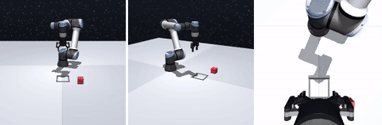
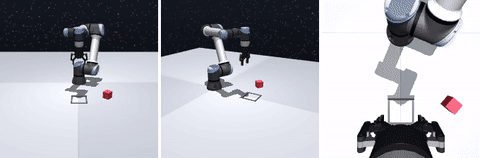

# Baseline (a): cube-only ACT, data sweep 100 / 200 / 300

> Superseded: these runs used our own ACT reimplementation (delta actions, chunk 10, no
> temporal ensembling), since replaced by the original ACT (`third_party/act`). Kept for the
> findings below; see "Diagnostics" for why.

8–9 November 2026. Image-only ACT trained on source (red cube) demonstrations only, one
training seed per data size, to apply the R2 rule. Protocol fixed beforehand in
[`configs/data.toml`](../../configs/data.toml) `[protocol]`; no test seed has been used.

## Setup

| | |
|---|---|
| Code | our former ACT reimplementation (removed; in the pre-reset history), OCBench fork `2aae696` |
| Data | [Autobrik/ecse552-ocbench-block](https://huggingface.co/datasets/Autobrik/ecse552-ocbench-block) at `aa4e3ee`, `source-n300-seed0`, first 100 / 200 / 300 episodes, 80/20 split by episode |
| Model | [`configs/act_baseline_a.toml`](../../configs/act_baseline_a.toml): ACT without joint inputs, 51.5 M parameters, chunk 10, batch 8, lr 1e-5, KL 10, 100k steps |
| Compute | Modal, one A10G per run, about 26 it/s, 66–69 min per run |
| Checkpoints | [Autobrik/ecse552-act-baseline-a](https://huggingface.co/Autobrik/ecse552-act-baseline-a) `n<demos>/seed0/` (`best.pt`, `last.pt`, `selected.pt`, `selection.json`, metrics) |
| Curves | W&B `mu-robotics/ecse552`, group `act_baseline_a` (links in the table) |

```bash
modal run scripts/modal_train.py --smoke
modal run --detach scripts/modal_train.py --num-episodes 100,200,300 --seeds 0
hf download Autobrik/ecse552-act-baseline-a --local-dir outputs/act_baseline_a
MUJOCO_GL=egl uv run python scripts/select_checkpoint.py outputs/act_baseline_a/n*/seed0
MUJOCO_GL=egl uv run python scripts/diagnose_failures.py outputs/act_baseline_a/n200/seed0/selected.pt
```

## Results

Validation success: 100 rollouts on the source cube from validation seeds 900,000+ (95%
Wilson interval in brackets). The selected checkpoint is the one with higher validation
success (ties to `best.pt`).

| Demos | Train / val episodes | `best.pt`: step, val L1, success | `last.pt`: val L1, success | Selected | W&B |
|---:|---|---|---|---|---|
| 100 | 80 / 20 | 4k, **0.287**, 8% [4, 15] | 0.323, **23%** [16, 32] | `last.pt` | [run](https://forge.coreweave.com/wandb/mu-robotics/ecse552/runs/qwzg9cyv) |
| 200 | 160 / 40 | 12k, **0.275**, 10% [6, 17] | 0.288, **49%** [39, 59] | `last.pt` | [run](https://forge.coreweave.com/wandb/mu-robotics/ecse552/runs/mp9dw8ru) |
| 300 | 240 / 60 | 28k, **0.280**, 28% [20, 37] | 0.297, **31%** [23, 41] | `last.pt` | [run](https://forge.coreweave.com/wandb/mu-robotics/ecse552/runs/2mo13a12) |

Failure modes of the selected checkpoints (`scripts/diagnose_failures.py`, the same 100
validation seeds, rerun; see the note on evaluation noise):

| Demos | Success | Never lifted the cube | Placed < 10 cm but not fully inside | Lifted, ended far | Inside, not released/still |
|---:|---:|---:|---:|---:|---:|
| 100 | 14 | 69 | 11 | 6 | 0 |
| 200 | 55 | 37 | 5 | 2 | 1 |
| 300 | 47 | 41 | 9 | 3 | 0 |

| Success (n200) | Grasp missed (n200): the empty gripper goes to the square |
|---|---|
|  |  |

## Findings

1. **Validation L1 picks the wrong checkpoint.** In every run the lowest-L1 checkpoint
   comes early (4k–28k steps) and succeeds far less than the final one (8% vs 23%, 10% vs
   49%). This reproduces robomimic's observation on our task and is why selection uses
   rollouts.
2. **No size reaches 80%**, so by the pre-registered R2 rule all methods use **300 source
   demos**. The best policy succeeds about half the time.
3. **300 demos did worse than 200 at a fixed 100k steps.** Its final training L1 is the
   highest (0.108 vs 0.067 and 0.056): with the same number of updates each demo is seen
   fewer times (about 40 passes vs 60 and 120), so it is likely undertrained. One seed per
   size also leaves several points of noise.
4. **Grasping is the main failure** (37–69% of rollouts never lift the cube), followed by
   placements just outside the 12 cm square.
5. **Evaluation is noisy because GPU rendering is not bit-exact.** The policy is
   deterministic (same image, same actions), but two renders of the same state differ by
   one intensity level in a few pixels, and that flips 11 of 40 episode outcomes when the
   same seeds are rerun (35% vs 37.5% overall). The diagnosis rerun above shows the same
   effect (n300: 31% at selection, 47% on rerun). Success rates must be reported with
   intervals and enough rollouts; `best` vs `last` for n300 is within noise.

## Decision and open questions

- R2 (pre-registered): **300 source demos** for every method.
- Before training more seeds, the team should decide on the training recipe, tuned on
  source validation only (allowed by the protocol):
  - **Longer training for 300 demos** (success rose from `best` to `last` in every run;
    n300 has not converged).
  - **Temporal ensembling or a shorter open-loop horizon at inference** (ACT's original
    evaluation uses temporal ensembling; the proposal executes chunks open loop). This needs
    no retraining and can be tested on the existing checkpoints.
  - **More rollouts per evaluation** (for example 200) to shrink the intervals, given the
    rendering noise.
- Then: 3 training seeds of the chosen recipe, and the first test-seed evaluation on source
  and target A.

## Diagnostics (9 November 2026)

Validation rollouts of the selected checkpoints (100 each):

| | n200 | n300 |
|---|---:|---:|
| Success from **training** initial states | 70% | 60% |
| Success from validation initial states | 51% | 40% |
| Chunk of 10, open loop (default) | 54% | 35% |
| Replan every 5 steps | 58% | 46% |
| Replan every step | 9% | 7% |
| Temporal ensembling (m = 0.01 / 0.1) | 21% / 22% | 14% / 15% |

- Even training states succeed only 60–70%: an execution problem, not only generalization.
- Re-querying or averaging chunks fails with **delta** actions (each delta assumes the state
  it was predicted from); ACT uses absolute targets, where ensembling is well defined.
- Grasp failures show no consistent pattern with cube yaw or position.
- Against the original ACT ([tonyzhaozh/act](https://github.com/tonyzhaozh/act)): absolute
  joint targets, fixed cube orientation, deterministic expert, one 480 x 640 camera, robot
  state as input, ~10k training steps in sim, temporal ensembling. We trained 10x more steps,
  so undertraining is unlikely. Decision: run the original ACT, with absolute targets.
