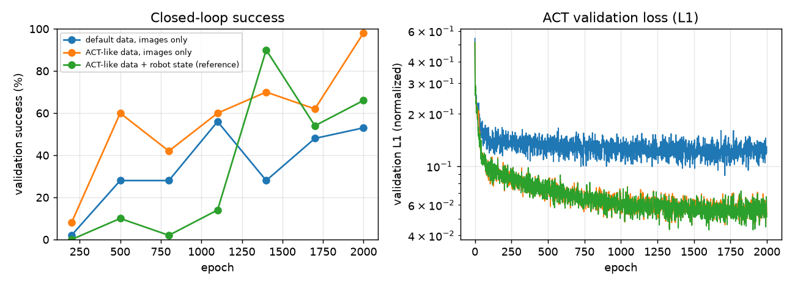

# Baseline (a) with the original ACT: data variants and robot state

9 November 2026. Original ACT (`third_party/act`, unmodified) trained on 300 source demos,
seed 0, then selected on validation rollouts and tested once on the source cube and target A.
Runs and data were renamed on 10 November (`act_original` → `act_stochastic`, `act_clean` →
`act_deterministic`, `clean` data → `deterministic`, unlabeled → `stochastic`); W&B keeps the
old run names.

> These results are on the data before 10 November 2026 (dataset `3d0229e`), whose
> "deterministic" expert still turned the cube grasp by ±90° in 30% of episodes. The project
> data was then re-recorded without grasp turns; results on it are in
> [baselines.md](baselines.md).

## Setup

| | |
|---|---|
| Code | `main` at `5c46c01` (`act_stochastic` trained at `5f9a539` from dataset `aa4e3ee`, same episodes); ACT `742c753`; OCBench fork `54783cb`. Evaluations ran on the working tree that became `548c363` (epoch bookkeeping only) |
| Data | [Autobrik/ecse552-ocbench-block](https://huggingface.co/datasets/Autobrik/ecse552-ocbench-block) at `3d0229e` (same episodes as `6b5e02b`, with the folders renamed) |
| Training | ACT README settings, chunk 20 (2 s at 10 Hz), 2,000 epochs, upstream 80/20 split; one A10G, ~2 h per run |
| Selection | `policy_best` (lowest validation loss) vs `policy_last`, 100 source validation rollouts (seeds 900,000+) |
| Test | 100 rollouts per object (seeds 1,000,000+), temporal ensembling (k = 0.01), 95% Wilson intervals |

| Run | Data | Robot state | Checkpoints | Curves |
|---|---|---|---|---|
| `act_stochastic` | `source-stochastic-n300-seed0`: random cube yaw, stock OCBench expert (detours, random speed) | no | [HF](https://huggingface.co/Autobrik/ecse552-act-stochastic) | [W&B](https://forge.coreweave.com/wandb/mu-robotics/ecse552/runs/vunir7pa) |
| `act_deterministic` | `source-deterministic-n300-seed0`: yaw fixed at 0, deterministic expert (like ACT's sim) | no | [HF](https://huggingface.co/Autobrik/ecse552-act-deterministic) | [W&B](https://forge.coreweave.com/wandb/mu-robotics/ecse552/runs/86jkbauq) |
| `act_deterministic_proprio` | same as `act_deterministic` | **yes** (reference only; breaks R3) | [HF](https://huggingface.co/Autobrik/ecse552-act-deterministic-proprio) | [W&B](https://forge.coreweave.com/wandb/mu-robotics/ecse552/runs/thyrbqin) |

## Results

| Run | Validation: best / last | Selected | **Test source** | **Test A** | Latency p95 |
|---|---|---|---:|---:|---:|
| `act_stochastic` | 40% / 53% | last (epoch 1999) | **53%** [43, 62] | **0%** [0, 4] | 10 ms |
| `act_deterministic` | 61% / 98% | last (epoch 1999) | **99%** [95, 100] | **7%** [3, 14] | 10 ms |
| `act_deterministic_proprio` | 44% / 66% | last (epoch 1999) | **69%** [59, 77] | **1%** [0, 5] | 10 ms |
| `act_deterministic`, **100 demos** (R2 check, 10 Nov) | 35% / 37% | last (epoch 1999) | not tested | not tested | |

Failure modes on the source cube (100 validation rollouts of the selected checkpoint;
success / never lifted / placed just outside / lifted, ended far / inside, not released):
`act_stochastic` 48 / 38 / 11 / 2 / 1; `act_deterministic` 99 / 1 / 0 / 0 / 0;
`act_deterministic_proprio` 68 / 29 / 1 / 2 / 0.

### Execution and test distribution (10 November, validation rollouts, `act_deterministic`)

| Execution of the 20-action chunks | Success |
|---|---:|
| Temporal ensembling, k = 0.01 (ACT; used everywhere) | **98%** |
| Open loop, whole chunk then re-query (proposal) | 41% |
| Re-query every 10 steps | 32% |
| Re-query every step, first action only | 1% |

`act_stochastic` on fixed-yaw validation starts: **71%** (53% on its own random-yaw starts;
`act_deterministic` 98%): the stochastic-vs-deterministic gap is about 18 points of harder
test distribution and 27 points of demonstration variability.

## Findings

1. **Deterministic demonstrations are solved with images only: 99% on the source cube** (R3
   kept, R2's 80% met at 300 demos). With the stochastic ones (random yaw, stock expert) the
   same code reaches 53% (71% on fixed-yaw starts): as in the ACT paper (scripted vs. human
   data), demonstration variability matters most. The "deterministic" expert still has
   OCBench's grasp randomness (a ±90° wrist mode in 30% of episodes, a pick hold in 40%,
   ~1 cm contact jitter); only detours and speed are removed.
2. **Changing only the colour breaks every policy (0–7% on target A).** The baseline (a) floor
   is near zero, so the methods that use A's videos have a large gap to close.
3. **Robot state did not help here (69% vs 99%)**, one seed only. Its curve jumps between
   checkpoints (90% at epoch 1400, 54% at 1700), so this needs more seeds before any claim;
   policies that over-rely on proprioception are a known failure (copycat problem).
4. **The lowest-validation-loss checkpoint was always worse** than the last one (40/53, 61/98,
   44/66), and success varies widely between nearby checkpoints while the loss curve is
   smooth: closed-loop selection matters, and 3 training seeds are needed.
5. **R6 holds:** 10 ms per policy call (temporal ensembling queries every step).
   **Temporal ensembling is essential**: executing chunks open loop, as the proposal
   planned, drops the same policy from 98% to 41%.
6. Operations: Modal preempted `act_deterministic` once; upstream ACT cannot resume, so the run
   restarted from zero (Modal does not offer non-preemptible GPU containers).

An independent review of the adapter against upstream ACT (export, statistics, dataset,
optimisation, inference, ensembling, protocol, numbers) found no error (10 November 2026);
its one interpretive finding is the test-distribution split above.

## Decisions (10 November 2026)

- **The deterministic data is the project data** for every method and object
  (`configs/data.toml`); the stochastic run stays as the reason.
- **R2: 300 source demos for every method.** 100 demos reach 37% on validation (rule: 100 if
  at least 80%, else 300; [W&B](https://forge.coreweave.com/wandb/mu-robotics/ecse552/runs/xqe6idb3)).
- Next: two more training seeds at 300 demos, then the full test.
