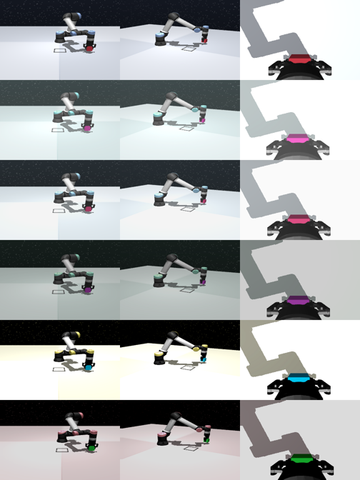

# Method (e): source only with image augmentation

10 November 2026. Implemented, trained and tested by Brik's session so that the comparison
is not blocked. **Gonzalo: review the settings below; they are a first choice, not a tuned one.**

## What it is

The baseline (a) with one change: every training sample is augmented. No target videos, no
target actions. It answers whether target videos are needed at all; since the gap of the
baseline is colour (A and D at 0%, B and C transfer), it is the strongest alternative.

| | |
|---|---|
| Config | [`configs/act_augment.toml`](../../configs/act_augment.toml): `act_deterministic.toml` plus `augment = true` |
| Code | `augment_images` and `AUGMENT` in [`src/action_free/act_original.py`](../../src/action_free/act_original.py); upstream ACT is not edited, the training dataset is wrapped |
| Colour | brightness, contrast and saturation ± 30%; hue over the full circle (± 0.5), so the red cube takes every colour |
| Geometry | shift of up to 4 pixels (of 224), edge pixels repeated |
| Per sample | one random draw, applied to the three cameras alike |
| Not augmented | validation loss, validation and test rollouts |
| Runs | 300 source demos, seeds 0, 1, 2; same selection and test as (a): every object, 100 rollouts |

First row: the original frame (front, side, wrist cameras). Other rows: five random draws.

Videos, for illustration only:
[Autobrik/ecse552-ocbench-source-augmented-sample](https://huggingface.co/datasets/Autobrik/ecse552-ocbench-source-augmented-sample)
(LeRobot, 20 source episodes, one draw per episode; training draws a new one per sample).
Made with `scripts/upload_lerobot_hf.py data/source-deterministic-n300-seed0 --augment-sample 20`.

## Open choices (Gonzalo)

- **Hue range.** The full circle is the favourable case for (e): it assumes the target may
  have any colour. A narrow range would not reach blue from red.
- **Shift size.** Kept small because the grasp needs millimetres; RAD uses larger crops.
- **Robot and background change colour too.** The jitter is applied to the whole image.
- No other augmentation (blur, cutout, noise) and no tuning: one setting, fixed before the
  results.

To change a setting: edit `AUGMENT`, commit, and launch
`modal run --detach scripts/modal_train.py --config configs/act_augment.toml --seeds 0,1,2`
(it overwrites the runs in `Autobrik/ecse552-act-augment`; test seeds are used once per
selected checkpoint).

## Results

Test success, 100 rollouts per object (seeds 1,000,000+), one test per selected checkpoint.
Trained on Modal (about 5 h per run), model repo
[Autobrik/ecse552-act-augment](https://huggingface.co/Autobrik/ecse552-act-augment).
(a) and (d) from [baselines.md](baselines.md); (d) is the oracle trained for that target.

| Test object | Seed 0 | Seed 1 | Seed 2 | (e) mean | Std | 95% Wilson, 300 rollouts | (a) mean | (d) mean |
|---|---:|---:|---:|---:|---:|---:|---:|---:|
| source (red cube) | 95% | 90% | 100% | 95.0% | 5.0 | [91.9, 96.9] | 90.7% | - |
| A (blue cube) | 97% | 100% | 99% | **98.7%** | 1.5 | [96.6, 99.5] | 0.3% | 85.7% |
| B (red 9x6x6 block) | 96% | 79% | 97% | 90.7% | 10.1 | [86.8, 93.5] | 82.3% | 88.3% |
| C (red 9x7x6 block) | 78% | 49% | 77% | 68.0% | 16.5 | [62.5, 73.0] | 59.0% | 46.0% |
| D (blue 9x7x6 block) | 72% | 58% | 70% | **66.7%** | 7.6 | [61.2, 71.8] | 0.0% | 92.7% |
| E (red 6x9x6 block, turned grasp) | 0% | 1% | 0% | 0.3% | 0.6 | [0.1, 1.9] | 0.0% | pending |

Selection (100 source validation rollouts): `policy_best` in the three seeds, 96% (epoch
1872), 91% (1932), 98% (1995); `policy_last` 62%, 57%, 70%.

- **Colour jitter closes the colour gap without any target data**: A from 0.3% to 98.7%, D
  from 0% to 66.7%. On A it is above the oracle (85.7%), so R4's ratio exceeds 1 there.
- **It does not hurt the source** (95.0% vs 90.7%) and is at least as good as (a) on the red
  blocks; per seed it is below (a) on B and C for seed 1 only.
- **What is left is geometry**: D (66.7%) is level with C (68.0%), the same 7 cm block in
  red. Once colour is handled, the blue block fails like the red one.
- **Consequence for (b) and (c)**: on A there is nothing left to gain over (e). On D the
  oracle reaches 92.7%, 26 points above (e): target videos can help there. A target that
  changes the behaviour, where (e) cannot help at all, is E ([target_E.md](target_E.md)).
- Limits: one augmentation setting, 3 seeds, and the hue range assumes the target colour is
  unknown but inside the jitter.
