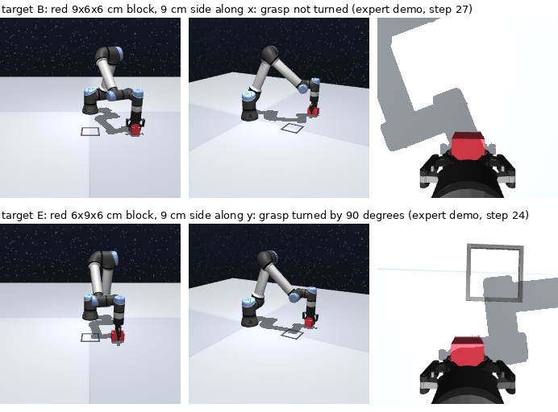

# Target E: a change of behaviour, not of appearance

11 November 2026. Added after the results of augmentation (e), by Brik's decision. It was
designed after seeing those results: say so in the report.

## Why

Method (e), source-only training with colour jitter, reaches 98.7% on the blue cube A
without any target data ([augmentation.md](augmentation.md)). Targets that only change the
appearance therefore cannot show what target videos add. A video of the target also shows
**what to do** with it; augmentation cannot supply that.

### Screening of candidates

Trained checkpoints of (a) and (e) (3 seeds each) and of oracle A (seed 1) on four candidate
objects, 20 validation rollouts each (seeds 900,000+). No training, no test seeds. The
candidates were built by a temporary script and are not in the repository; with 20 rollouts
each value is rough (about ± 20 points).

| Candidate | (a) Baseline | (e) Augmentation | Oracle A, seed 1 |
|---|---:|---:|---:|
| Cube with a black and white checker texture | 0%, 0%, 0% | 100%, 100%, 85% | 15% |
| Black cube | 0%, 0%, 0% | 80%, 70%, 75% | 70% |
| White cube | 0%, 0%, 0% | 80%, 90%, 60% | 5% |
| Red 6x9x6 cm block (9 cm side along y) | 0%, 0%, 0% | 0%, 0%, 0% | 0% |

- No change of appearance defeats (e), not even a texture or gray levels that the jitter
  never produces.
- The baseline fails on everything that is not plain red.
- Only the block that needs another grasp defeats every policy: it became target E.

Discarded without a test: blocks that only change the grasp height (the gripper pads are
about 4 cm long, so the source grasp still holds them) and narrower margins (C already shows
that 0.75 cm per side makes even the oracle unstable).

## The object

| | |
|---|---|
| Shape, colour | 6 x 9 x 6 cm block, red: B's block with the 9 cm side along y, the axis the gripper closes on |
| Why it needs another behaviour | 9 cm does not fit the 8.5 cm opening: the gripper must turn by 90 degrees and grasp across the 6 cm side |
| Appearance | Unchanged (red, same material), so augmentation has nothing to add |
| Definition | `E` in [`src/action_free/objects.py`](../../src/action_free/objects.py): `object_size = (0.06, 0.09, 0.06)` |
| Expert | OCBench fork `ad30d1b`: a block whose second side exceeds 8.5 cm is grasped across its first side with a fixed turn of +90 degrees; nothing else changes (grasp at the centre height, as for B) |
| Data | [`E-deterministic-n200-seed500000`](https://huggingface.co/datasets/Autobrik/ecse552-ocbench-block/tree/main/E-deterministic-n200-seed500000), 200 episodes, seeds from 500,000, dataset revision `b50de4d` |
| Expert success | 93.9% (200 kept of 213 attempts); the other collections reach 99% to 100% |
| Checks | Episode 0 replays exactly; tests cover size, colour, same start per seed, rendering and the turned grasp (`tests/test_collect.py`); cubes and B, C, D are not affected (their second side fits) |

The expert fails more often on E because the 9 cm side now lies along y, where the placed
block ends 0.8 ± 0.3 cm off the goal centre (100 expert episodes); a 9 cm side has 1.5 cm of
room in the 12 cm square. Failed attempts are not kept. Both turn directions were tried
on 100 episodes (+90 degrees: 95%; -90 degrees: 97%); +90 was kept because fewer of its
episodes leave the wrist range of the source demos.

## Risk for the IDM: the wrist angle

The IDM learns actions from the source demos only. The last wrist joint (`wrist_3`):

| | Source (300 demos) | E (200 demos) |
|---|---:|---:|
| Range of the joint | -4.60 to 3.22 rad | -6.28 to 2.09 rad |
| Frames with the joint below -1.2 rad | 2.5% (568 frames) | 75.5% |
| Episodes that rotate it by more than 1.2 rad after the lift | 100 | 82 |
| Episodes that leave the source range | - | 14 of 200 |
| Largest change in one step | 0.61 rad | 0.59 rad |

The source demos do rotate the wrist (while carrying and placing), and step sizes are alike.
But the turned grasp holds the joint where the source has few frames: three quarters of E's
frames lie in a region with 2.5% of the source frames. The IDM may label that region badly.

### Extra source demos for the IDM

[`source-turned-n100-seed600000`](https://huggingface.co/datasets/Autobrik/ecse552-ocbench-block/tree/main/source-turned-n100-seed600000):
100 demos of the **source cube** with every grasp turned by +90 degrees (expert `turned`,
fork `4d7751f`; expert success 100%, seeds from 600,000, dataset revision `b7ef4c6`).

| Frames with `wrist_3` below -1.2 rad | |
|---|---:|
| Source, 300 demos | 565 (2.5%) |
| Source turned, 100 demos | 5,735 (78.4%) |
| Both | 6,300 (21.0%) |
| E | 75.5% of its frames |

Rule (Brik, 11 November 2026): **only the IDM trains on this collection.** Every policy,
(a), (e), (d) and the policy stage of (b) and (c), keeps the 300 source demos, so the results
already measured stay valid and all policies see the same labeled data.

Why this is within the problem:

- It is labeled data of the source object only. No target action is used (R1), and the
  images show the red cube, not E.
- The problem assumes labeled demos of the source and action-free videos of the target. It
  does not fix which motions the source demos show; an IDM can only label motions it has
  seen, so the source demos must cover the robot's motions in the target videos.
- The turn is not what makes E hard for a policy: on the cube the turn is arbitrary, and
  nothing in these demos says that E needs it. That comes from E's videos.

Limits to state in the report:

- The IDM sees 400 labeled source demos and the policies 300.
- Not tested: whether a policy trained on the 300 + 100 demos would turn on E by chance. A
  control run (baseline on both collections, tested on E) would answer it.
- Not tested: whether the IDM needs this collection. Measure its label error on E against
  the true actions (evaluation only), with and without it, before training policies on
  its labels.

## Results

Test success, 100 rollouts per seed (seeds 1,000,000+), one test per selected checkpoint.

| Method | Seed 0 | Seed 1 | Seed 2 | Mean | Std | 95% Wilson, 300 rollouts |
|---|---:|---:|---:|---:|---:|---:|
| (a) Baseline | 0% | 0% | 0% | 0.0% | 0.0 | [0.0, 1.3] |
| (e) Augmentation | 0% | 1% | 0% | 0.3% | 0.6 | [0.1, 1.9] |
| (d) Oracle E | pending | pending | pending | | | |

- Neither source-only method solves E: the policy must be shown the turned grasp.
- Oracle E (`configs/act_oracle_E.toml`, source + E with true actions, seeds 0, 1, 2) was
  launched on Modal on 11 November 2026 at 02:44. When it ends: select each checkpoint on
  100 source validation rollouts and test it once on E and on source, as for the other
  oracles ([baselines.md](baselines.md)).
- E is a usable target only if the oracle is clearly above 0%; the expert's 93.9% bounds it.
